# ⚡ Electricity Billing & Management System

[](https://www.java.com/)
[](https://www.mysql.com/)
[](https://github.com/dentonujjwal)
[](LICENSE)

A complete, production-grade desktop application developed in **Java (Swing & AWT)** backed by **MySQL**. The system automates electrical utility billing operations, customer account management, dynamic tariff calculation, multi-mode bill payments, and historical consumption analytics for both **Administrators** and **Consumers**.

---

## 👨‍🎓 Project Information
- **Developer:** Ujjwal Rai
- **Degree:** B.Sc (Information Technology)
- **GitHub:** [@dentonujjwal](https://github.com/dentonujjwal)
- **Email:** [ujjwailrai@gmail.com](mailto:ujjwailrai@gmail.com)

---

## 💻 1. Core Modules & Implementation Code

### 🔐 Module 1: Authentication & Database Connectivity
Handles secure role-based access (Admin vs. Customer) and establishes persistent JDBC connections with the MySQL server.

- **Files:** `Login.java`, `Signup.java`, `database.java`
- **Key Code Snippet (`database.java`):**
```java
package electricity.billing.system;

import java.sql.*;

public class database {
    Connection connection;
    Statement statement;
    public database(){
        try {
            connection = DriverManager.getConnection(
                "jdbc:mysql://localhost:3306/Bill_system", "root", "YOUR_PASSWORD"
            );
            statement = connection.createStatement();
        } catch (Exception e){
            e.printStackTrace();
        }
    }
}
```

---

### 👤 Module 2: Customer Registration & Meter Setup
Allows administrators to enroll new consumers with auto-generated unique 6-digit meter numbers, regional state/city dropdown selectors, and technical meter specifications (Location, Phase Code, Bill Type).

- **Files:** `newCustomer.java`, `meterInfo.java`
- **Key Code Snippet (`newCustomer.java`):**
```java
// Automatic meter number generation & record insertion
long number = first.nextLong() % 1000000;
meterNumText.setText("" + Math.abs(number));

String query_customer = "insert into new_customer values('" + sname + "','" + smeter 
    + "','" + saddress + "','" + scity + "','" + sstate + "','" + eemail + "','" + sphone + "')";
String query_signup = "insert into Signup values('" + smeter + "','','" + sname + "','','')";
c.statement.executeUpdate(query_customer);
c.statement.executeUpdate(query_signup);
```

---

### 💡 Module 3: Dynamic Bill Computation & Invoice Generation
Computes consumption charges dynamically using unit tariffs, fixed meter rent, service taxes, and Swachh Bharat cess. Generates formatted printable billing slips.

- **Files:** `calculate_bill.java`, `generate_bill.java`
- **Key Code Snippet (`calculate_bill.java`):**
```java
int totalBill = 0;
int units = Integer.parseInt(sunit);
String query_tax = "select * from tax";
ResultSet resultSet = c.statement.executeQuery(query_tax);
while (resultSet.next()){
    totalBill += units * Integer.parseInt(resultSet.getString("cost_per_unit"));
    totalBill += Integer.parseInt(resultSet.getString("meter_rent"));
    totalBill += Integer.parseInt(resultSet.getString("service_charge"));
    totalBill += Integer.parseInt(resultSet.getString("swacch_bharat"));
    totalBill += Integer.parseInt(resultSet.getString("fixed_tax"));
}
String query_total_bill = "insert into bill values('" + smeterNo + "', '" 
    + smonth + "','" + sunit + "', '" + totalBill + "','Not Paid')";
c.statement.executeUpdate(query_total_bill);
```

---

### 💳 Module 4: Bill Payment & Multi-Channel Simulation
Enables consumers to query outstanding bills by month and clear payments via Net Banking simulation or UPI QR code scan, automatically updating payment statuses in MySQL.

- **Files:** `pay_bill.java`, `payment_bill.java`, `bill_analysis.java`
- **Key Code Snippet (`payment_bill.java`):**
```java
// Updating bill status to Paid upon successful transaction
c.statement.executeUpdate(
    "update bill set status = 'Paid' where meter_no = '" + meter + "' and month = '" + month + "'"
);
JOptionPane.showMessageDialog(null, "Payment Successful! Bill Marked as Paid.");
```

---

### 📋 Module 5: Customer Directory & Records Management
Provides searchable and printable tables for customer profiles, deposit logs, and bill payment history.

- **Files:** `customer_details.java`, `deposit_details.java`, `view_information.java`, `update_information.java`

---

## 📸 2. Application Screenshots & System Diagrams

### ⚡ Splash Screen
Animated loading interface with gradient progress bar upon application launch.
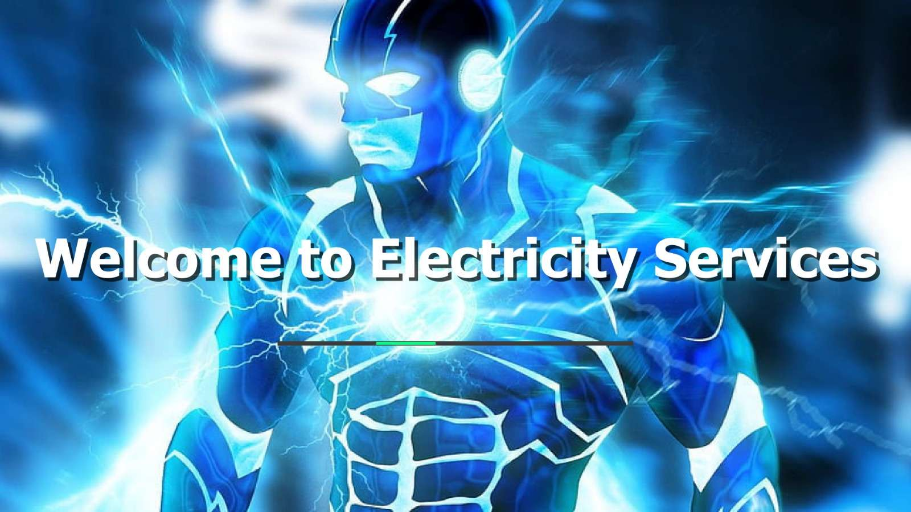

---

### 🖥️ Main Dashboard
Comprehensive central interface with dedicated top-level menus for Operations, User Information, and Utilities.
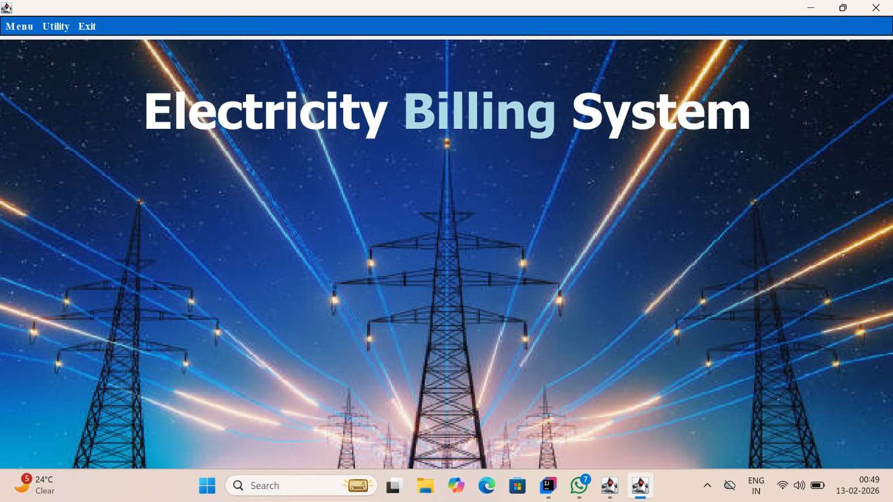

---

### 📋 Admin Operations Menu
Options for New Customer creation, Customer Records, Deposit Details, and Bill Calculation.
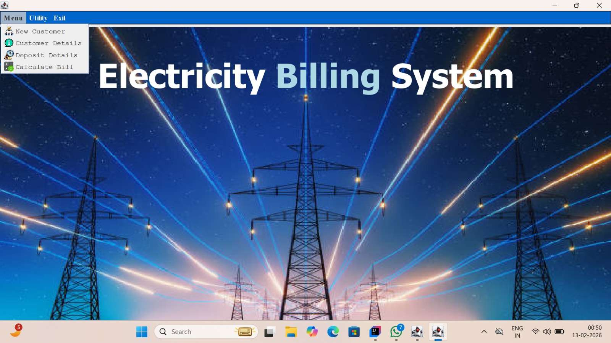

---

### 👤 User Information Menu
Allows viewing customer profiles and updating contact/location information.
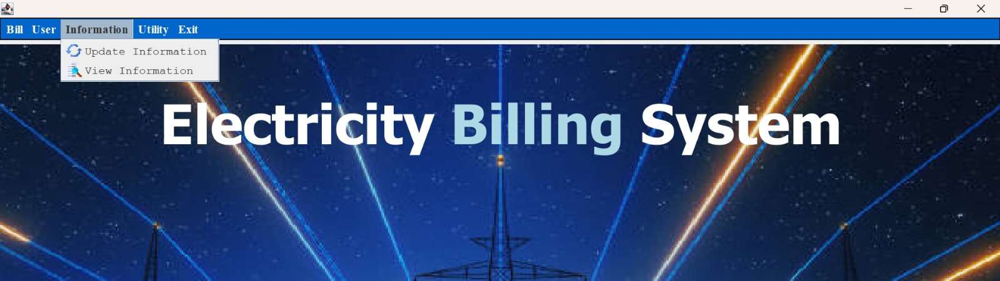

---

### 🛠️ Utilities Menu
Quick launch integration for system utilities (Notepad & Calculator).
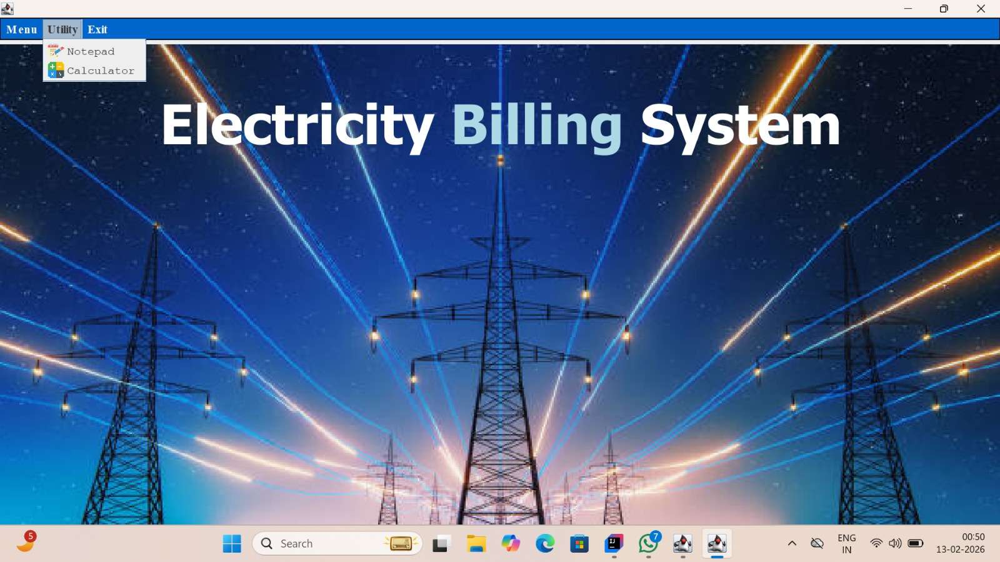

---

### 📊 System Use Case Diagram
Interaction model defining customer capabilities vs. administrator controls.
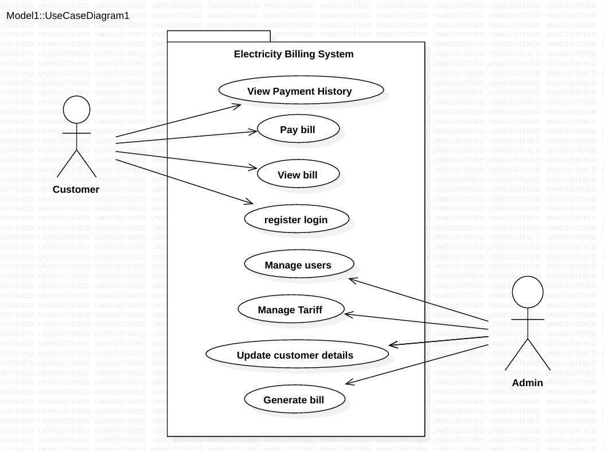

---

### 🗂️ Entity-Relationship Diagram (ERD)
Relational entity modeling depicting cardinality between Admin, Customer, Meter, Bill, and Payment entities.
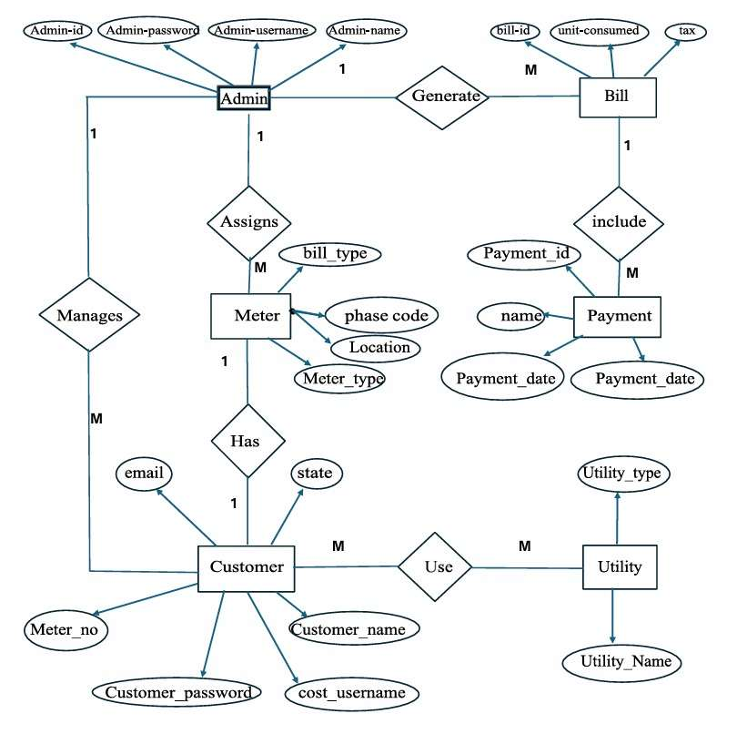

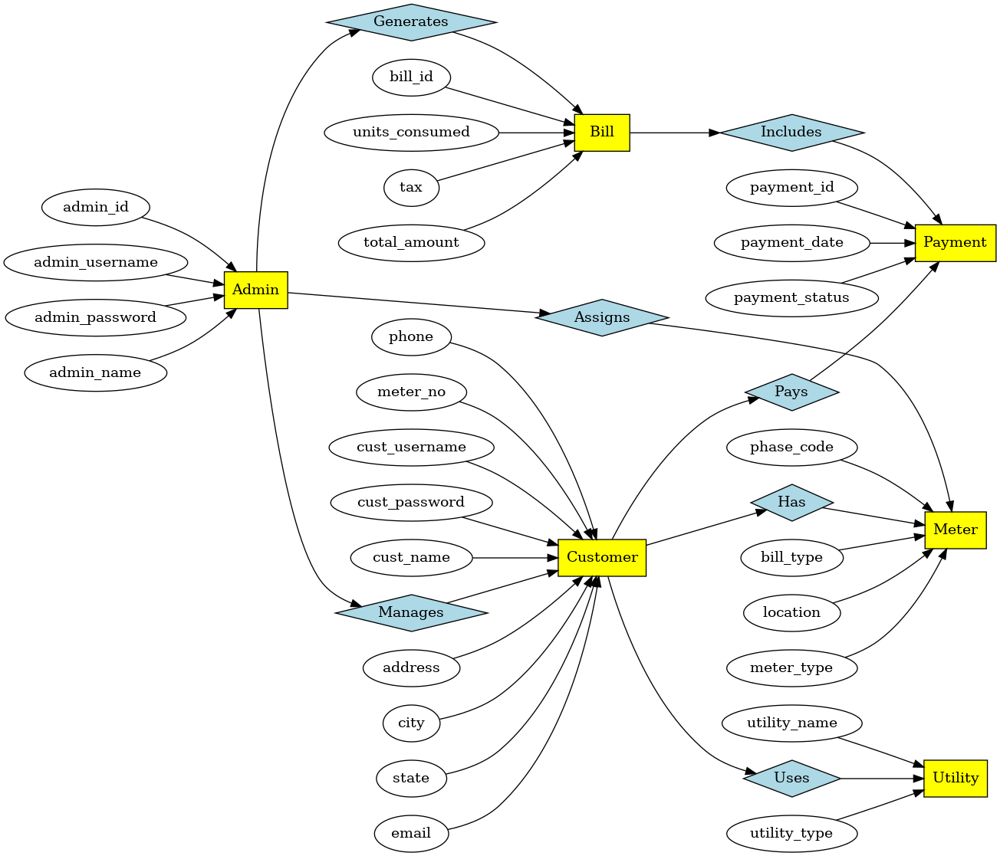

---

### 📑 Event Trigger & Response Documentation
Complete workflow mapping of application triggers, use cases, system responses, and target databases.
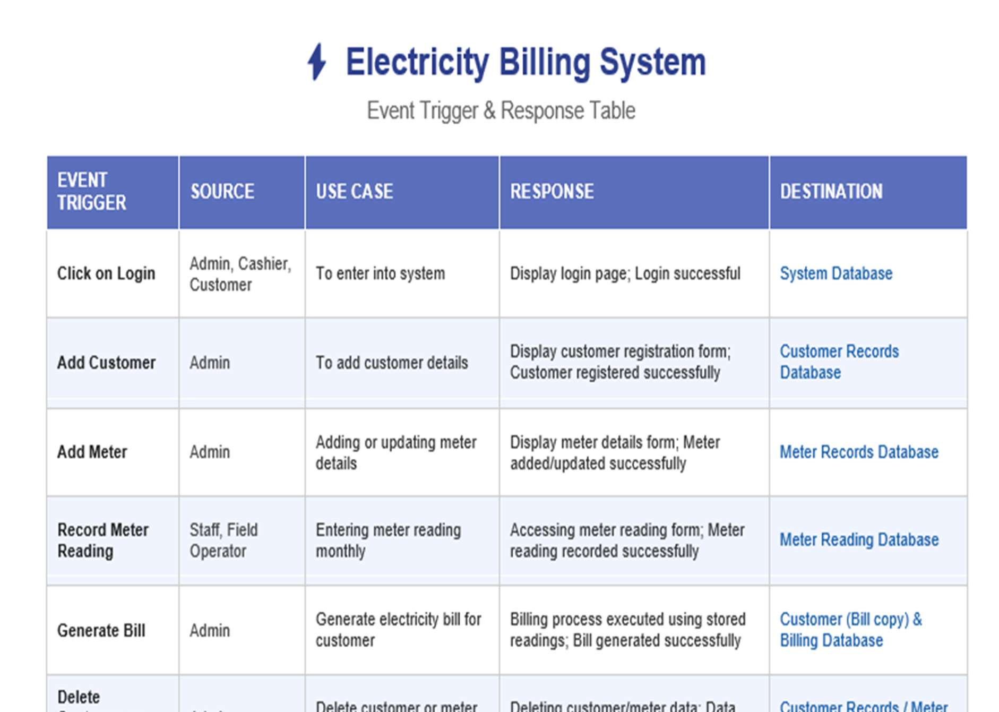
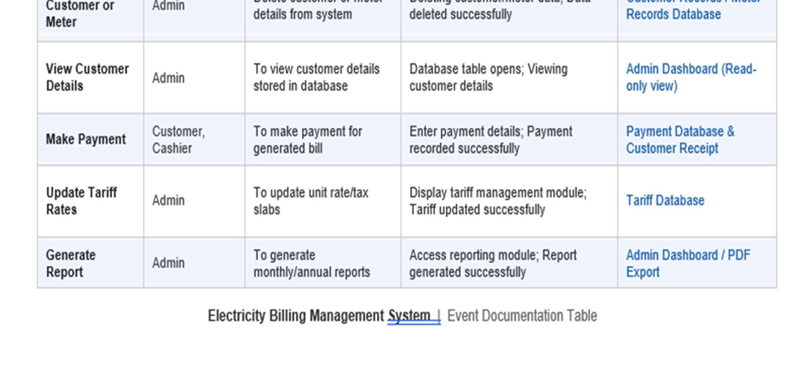

---

## 🗄️ 3. Database Architecture & Live Records

### 📊 MySQL Database Schema (`Bill_system`)
The application uses 5 relational tables stored in [`database/Bill_system.sql`](database/Bill_system.sql):

```sql
-- 1. Table for user logins and registration
CREATE TABLE Signup (
    meter_no VARCHAR(50),
    username VARCHAR(50),
    name VARCHAR(100),
    password VARCHAR(50),
    usertype VARCHAR(50)
);

-- 2. Table for customer personal information
CREATE TABLE new_customer (
    name VARCHAR(100),
    meter_no VARCHAR(50) PRIMARY KEY,
    address VARCHAR(255),
    city VARCHAR(50),
    state VARCHAR(50),
    email VARCHAR(100),
    phone_no VARCHAR(20)
);

-- 3. Table for meter specifications
CREATE TABLE meter_info (
    meter_no VARCHAR(50),
    meter_location VARCHAR(50),
    meter_type VARCHAR(50),
    phase_code VARCHAR(50),
    bill_type VARCHAR(50),
    Days VARCHAR(50)
);

-- 4. Table for tariff rates & tax charges
CREATE TABLE tax (
    cost_per_unit VARCHAR(50),
    meter_rent VARCHAR(50),
    service_charge VARCHAR(50),
    service_tax VARCHAR(50),
    swacch_bharat VARCHAR(50),
    fixed_tax VARCHAR(50)
);

-- 5. Table for bills and payment statuses
CREATE TABLE bill (
    meter_no VARCHAR(50),
    month VARCHAR(50),
    unit VARCHAR(50),
    total_bill VARCHAR(50),
    status VARCHAR(50)
);
```

---

### 📸 Database Live Records (Screenshots)

#### 1. `Signup` Table Query Output:
Live records of registered Administrators and Consumers with encrypted/hashed access rights:
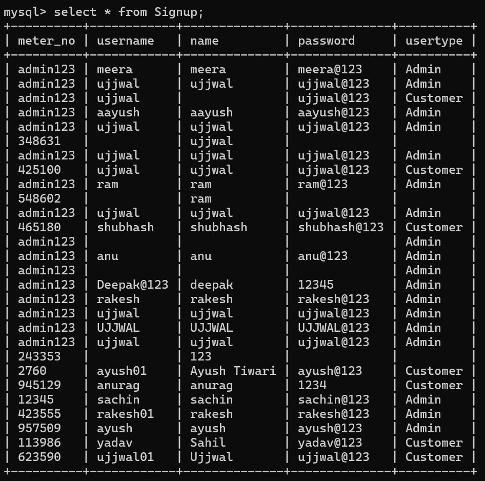

#### 2. `bill` Table Query Output:
Real-time ledger of calculated bills, units consumed, billed amounts, and payment status (`Paid` / `Not Paid`):
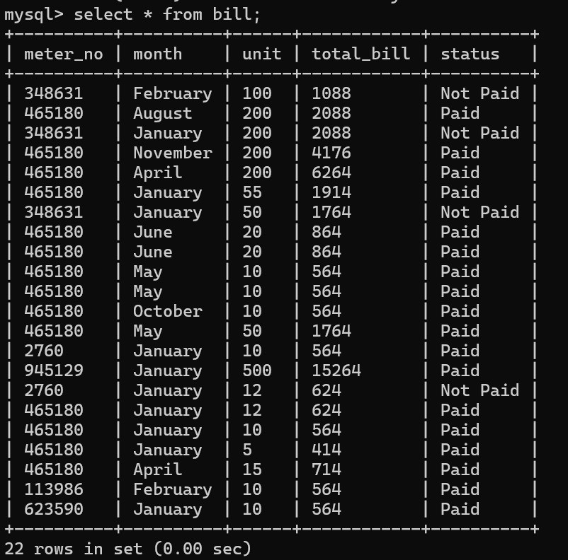

---

## ⚙️ Installation & How to Run

1. **Clone the repository:**
   ```bash
   git clone https://github.com/dentonujjwal/Ujjwal-Electricity-Bill-Payment.git
   ```

2. **Setup the Database:**
   - Import [`database/Bill_system.sql`](database/Bill_system.sql) into MySQL Workbench or via command line:
     ```bash
     mysql -u root -p < database/Bill_system.sql
     ```

3. **Configure MySQL Credentials:**
   - Open [`src/electricity/billing/system/database.java`](src/electricity/billing/system/database.java) and set your MySQL password.

4. **Run Application:**
   - Open the project in IntelliJ IDEA, Eclipse, or NetBeans.
   - Add JAR files from `lib/` directory to the Project Libraries.
   - Run `Splash.java` or `Login.java`.

---

## 📄 License
This project is licensed under the [MIT License](LICENSE).
